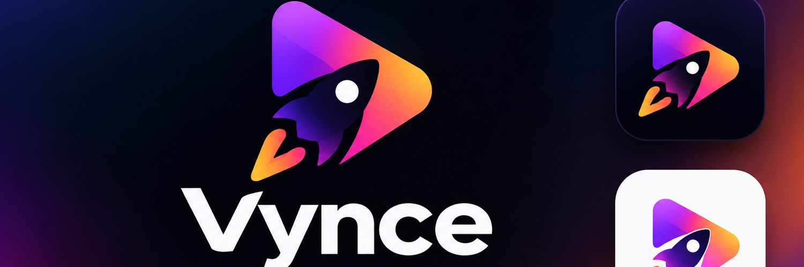

# Vynce

  

  <strong>Create · Edit · Ship</strong> 
  An AI-powered creative video concept for turning ideas into polished visual stories.

## Name

**Vynce**

A short, distinctive name for a modern creative tool. It is designed to feel fast, memorable, and flexible as the product grows.

## Logo

The Vynce mark combines a **play symbol** with a **rocket motif**:
- **Play shape** represents video, creation, and getting an idea in motion.
- **Rocket** represents speed, momentum, and shipping finished work.
- **Purple → pink → orange → yellow gradient** brings an expressive, energetic creator vibe.
- **Deep navy backgrounds** give the brand a cinematic, premium feel.

The main logo and app-icon explorations are included here:

## Banner

The README banner uses the selected Vynce logo, gradient palette, and the tagline **Create · Edit · Ship**.

## About

Vynce is a project concept for an AI-assisted video creation workflow. The goal is to help people move from a rough idea to a shareable video with less friction—bringing ideation, editing, and publishing into one streamlined experience.

The visual identity is bold, playful, and cinematic: a gradient play-and-rocket mark paired with clean typography.

## General Use Cases

- **Idea to video:** Turn a prompt, concept, or short brief into a video starting point.
- **Product demos:** Create concise demos that explain a product, feature, or workflow.
- **Social content:** Develop short-form videos for social platforms and communities.
- **Launch videos:** Shape launch announcements, feature reveals, and project showcases.
- **Storyboarding:** Explore visual directions before committing to a full edit.
- **Creator workflows:** Reduce repetitive steps between drafting, editing, and sharing.

> **Project status:** These are high-level project concepts and intended use cases, not a claim that every capability is already implemented.

## Brand Assets

- `assets/vynce-brand-identity.png` — selected Vynce brand poster and logo variations.
- `assets/vynce-logo-concepts.png` — original logo exploration poster.
- `assets/vynce-banner.png` — wide banner for the README or project page.

---

Made for ideas that are ready to move.

