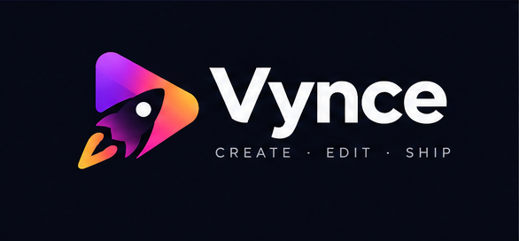
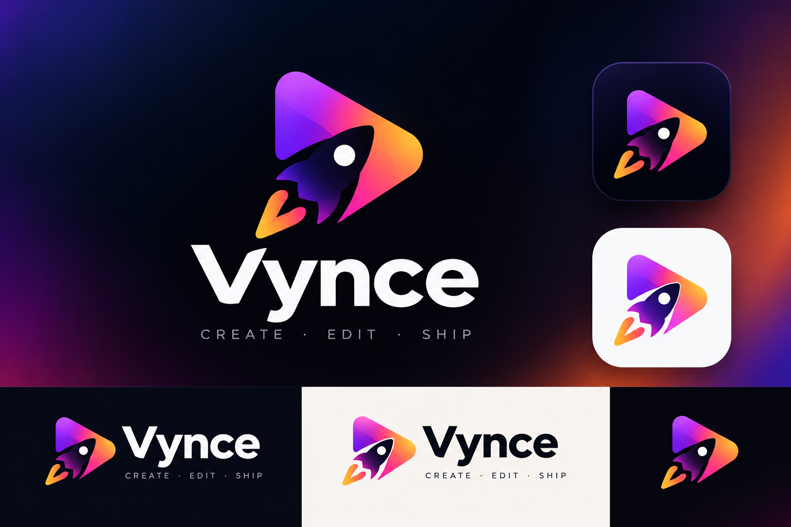

# Vynce

  

  <strong>Your Vision. Our Mision.</strong> 
  <strong>Create · Edit · Ship</strong> 
  An AI-powered creative video concept for turning ideas into polished visual stories.

## About

Vynce is a project concept for an AI-assisted video creation workflow. The goal is to help people move from a rough idea to a shareable video with less friction—bringing ideation, editing, and publishing into one streamlined experience.

The visual identity is bold, playful, and cinematic: a gradient play-and-rocket mark paired with clean typography.

## General Use Cases

- **Idea to video:** Turn a prompt, concept, or short brief into a video starting point.
- **Product demos:** Create concise demos that explain a product, feature, or workflow.
- **Social content:** Develop short-form videos for social platforms and communities.
- **Launch videos:** Shape launch announcements, feature reveals, and project showcases.
- **Storyboarding:** Explore visual directions before committing to a full edit.
- **Creator workflows:** Reduce repetitive steps between drafting, editing, and sharing.

> **Project status:** These are high-level project concepts and intended use cases, not a claim that every capability is already implemented.

Made for ideas that are ready to move.

## Wireframes for Logos

  

